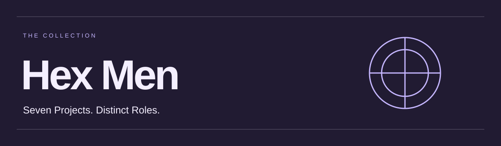

# Collection Reference

[Return to Hex Men](README.md).

# Hex Men

A master hub for seven independent projects by Jon Gosier: creating interfaces, inspecting design reasoning, testing rendered experiences, rehearsing workflows, evaluating simplification, sharpening language and auditing developer workspaces.

Hex Men is a playful nod to X-Men, whose character names inspired the collection. This is an independent collection with no official Marvel affiliation or endorsement. The collection name does not assign a character origin to every project.

## Choose the job

| Project | Role | Source entrypoint and status |
|---|---|---|
| [Dazzler](https://github.com/jongos/Dazzler) | Create and refine expressive visual interfaces through typography, color and composition; also supports visual documents and slides. | [`dazzler-frontend`](https://github.com/jongos/Dazzler/blob/main/skills/dazzler-frontend/SKILL.md). Public skill with documented installation options. |
| [Longshot](https://github.com/jongos/Longshot) | Independently attempt tasks in rendered interfaces and return reproducible findings with replayable evidence. | [`longshot-human-centered-ui`](https://github.com/jongos/Longshot/blob/main/skills/longshot-human-centered-ui/SKILL.md). Public review skill; agent inspection does not replace human research. |
| [Style Science](https://github.com/jongos/style-science) | Make design reasoning, declared constraints and supporting evidence inspectable. | [Project README](https://github.com/jongos/style-science/blob/main/README.md). Its GDC-0 foundation is an early engineering prototype, not a validated model of design quality or automatically an installable skill. |
| [Spiral](https://github.com/jongos/Spiral) | Rehearse role-limited asynchronous workflows before building; trace knowledge, ownership, waits and recovery. | [`spiral-workflow-rehearsal`](https://github.com/jongos/Spiral/blob/main/skills/spiral-workflow-rehearsal/SKILL.md). Public, research-informed draft; logical rehearsal, not human behavior simulation. |
| [Shatterstar](https://github.com/jongos/Shatterstar) | Propose reversible, evidence-backed simplification while protecting important tasks, accessibility and rare critical actions. | [`shatterstar-product-simplification`](https://github.com/jongos/Shatterstar/blob/main/skills/shatterstar-product-simplification/SKILL.md). Public, research-informed draft; recommendations do not authorize implementation deletion. |
| [Mojo](https://github.com/jongos/Mojo) | Remove repetition, needless nuance and overly cautious language from AI outputs. | [`mojo-language`](https://github.com/jongos/Mojo/blob/main/skills/mojo-language/SKILL.md). Write clear answers, product copy, instructions and agent updates. |
| [Colossus](https://github.com/jongos/Colossus) | Inventory explicitly selected developer workspaces read-only and surface evidence-backed questions; no cleanup is performed. | [`colossus`](https://github.com/jongos/Colossus/blob/main/skills/colossus/SKILL.md). Experimental Windows-first read-only milestone 7 (v0.7.0); every candidate remains protected. |

The original five project entries were checked on 2026-10-23; Mojo and Colossus were added on 2026-10-24, when Spiral and Shatterstar were also confirmed public. These descriptions are not maturity ratings or compatibility guarantees. Source repositories remain authoritative for current behavior, requirements, releases and validation limits.

## Optional complementary use

Start with the question that matters. Spiral can expose a missing notification before an approval workflow is built. Dazzler can create its interface, with Style Science supplying inspectable constraints where appropriate. Longshot can then independently test a rendered task. Shatterstar can assess whether overlapping destinations should be combined while preserving retrieval and recovery. Mojo can sharpen the resulting copy and agent updates. Colossus can separately inventory selected Windows development folders and surface questions about them.

This is an example of complementary use, not a mandatory dependency chain or automatic orchestration. Dazzler's source documents its own relationship to Style Science; consult each project's requirements. Any project can be selected for its relevant role without treating the whole collection as one installed system.

After making a skill available in a compatible host, example requests are:

- `Use $dazzler-frontend to refine this dashboard's hierarchy and visual character.`
- `Use $longshot-human-centered-ui to test this rendered task and report reproducible evidence.`
- `Use $spiral-workflow-rehearsal to trace this approval workflow using only each role's visible information.`
- `Use $shatterstar-product-simplification to assess these duplicate views while preserving comparison, export and recovery.`
- `Use $mojo-language to cut repetition, needless nuance and overly cautious language from this output.`
- `Use $colossus to audit these explicitly selected workspace roots and explain the evidence and coverage gaps.`

For Style Science, begin with its README and integration documentation. There is no collection-wide skill identifier, universal installer or implied permission to change an application, run experiments or send external messages.

## Catalog and maintenance

[catalog.json](catalog.json) is a small machine-readable directory, not an installation manifest. `skill` is null for Style Science; it does not invent a skill entrypoint. Verification dates describe the recorded snapshot, not continuous monitoring. Branch links follow upstream changes and are not version pins.

Keep source, issues and releases in the individual repositories. To update this hub, verify each repository's canonical URL, default branch, entrypoint/frontmatter and stated status; update the table and catalog together. Do not copy source packages into this repository or infer shared licensing or compatibility from membership.

## Landing Page Source

[Preview source](docs/index.html) · [Design notes](docs/DESIGN.md). The responsive static page is checked in but not publicly deployed. To preview a local checkout with Python available, run `python -m http.server 8000 --bind 127.0.0.1 --directory docs` and open `http://127.0.0.1:8000`. No installation is needed for the site itself.

The page uses original vector illustrations and locally bundled Inter and League Gothic fonts, with their notices in `docs/fonts/`. Public hosting or Pages configuration requires a separate publication decision; repository visibility remains unchanged.

[Desktop preview](docs/previews/desktop.jpg) · [Mobile preview](docs/previews/mobile.jpg) · [Validation scope](docs/VALIDATION.md)
